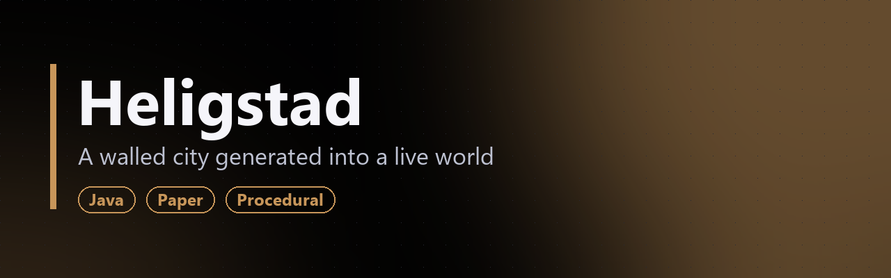
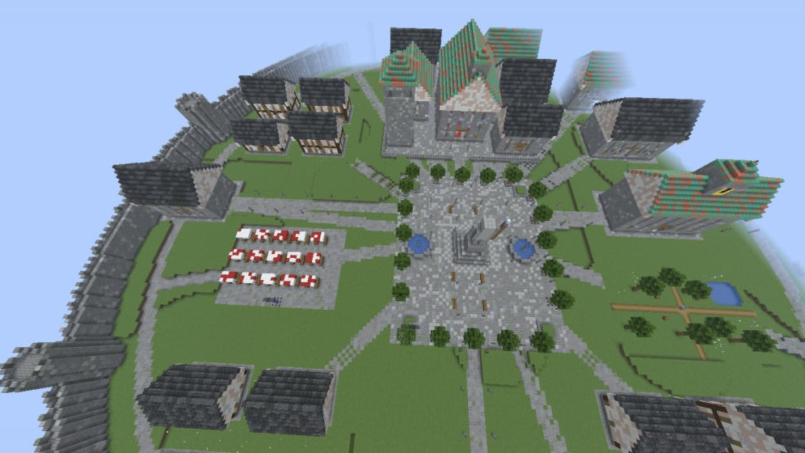

**[Русский](#русский) · [English](#english)**

> 🔒 Исходный код закрыт. В репозитории только описание плагина.
> 🔒 Source code is private. This repo contains a showcase only.

### Скриншоты с тестового сервера / Test server screenshots

_Результат `/gorod build` на Paper 26.1.2 / result of `/gorod build` on Paper 26.1.2._

---

## Русский

**Heligstad** — плагин для Paper (1.21), который строит город Хелигстад в уже существующем мире по плану местности: кольцо стен, здания с интерьерами, улицы и отдельную арену для скайварса в собственном мире.

### Особенности
- **Подготовка площадки.** Внутри стен земля выравнивается до общей отметки, а снаружи сводится к природному рельефу плавным откосом. Город не стоит на уступе, «вырезанном ножом».
- **Больше миллиона блоков без падения сервера.** Работы идут порциями по тикам, поэтому сторожевой таймер не убивает сервер.
- **Не затирает построенное.** Блок ставится только на воздух.
- **Интерьеры.** Кровати, скамьи из ступеней, баннеры с правильными состояниями блоков.
- **Разведка.** `/gorod scan` показывает разброс высот и воду на площадке до начала стройки.
- **Выгрузка.** `/gorod dump` сохраняет участок мира в файл для переноса.

**Команды:** `/gorod build | scan | tp | dump`.

---

## English

**Heligstad** is a Paper (1.21) plugin that builds the walled city of Heligstad into an existing world from a terrain plan: a ring of walls, buildings with interiors, streets, and a separate SkyWars arena in its own world.

### Highlights
- **Site preparation.** Inside the walls the ground is leveled to one height, and outside it blends back into natural terrain with a smooth slope. The city doesn't sit on a knife-cut ledge.
- **Over a million blocks without crashing the server.** Work is spread across ticks, so the watchdog never kills the server.
- **Never overwrites existing builds.** Blocks are placed only into air.
- **Interiors.** Beds, stair benches and banners with correct block states.
- **Survey.** `/gorod scan` reports height spread and water on the site before building.
- **Export.** `/gorod dump` saves a region of the world to a file for transfer.

**Commands:** `/gorod build | scan | tp | dump`.
